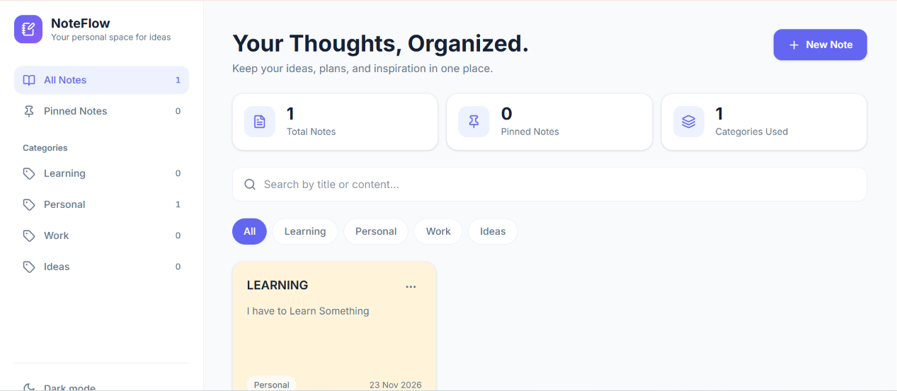
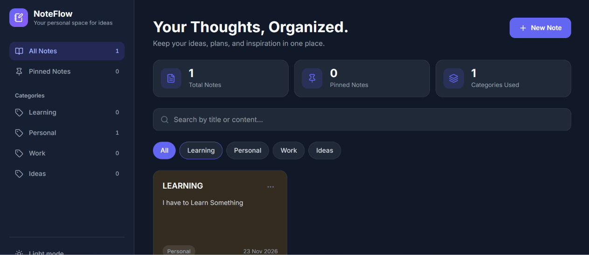
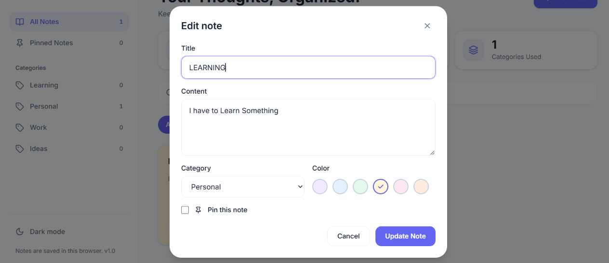
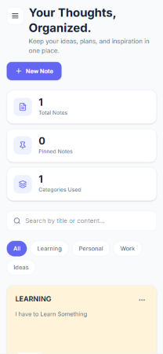

# NoteFlow

> Capture ideas. Organize thoughts. Stay productive.

NoteFlow is a modern, responsive, browser-based notes application developed as part of the **Syntecxhub Web Development Internship — Week 1, Project 3**.

It provides a simple and intuitive workspace to create, organize, search, and manage notes. The application runs entirely in the browser, with notes and theme preferences persisted using `localStorage`. No account or backend service is required.

## Features

- **Create, Edit & Delete:** Easily manage notes with a dedicated editor and delete confirmation.
- **Category Organization:** Organize notes into Learning, Personal, Work, and Ideas categories.
- **Search & Filter:** Search notes by title or content and combine searches with category filters.
- **Pin Notes:** Keep important notes accessible, with pinned notes displayed first.
- **Note Colors:** Choose from six different colors to visually organize notes.
- **Theme Switching:** Switch between Light and Dark modes, with the selected theme remembered after refresh.
- **Dashboard Statistics:** View live statistics about total notes, pinned notes, and categories.
- **Responsive Design:** Use the application across desktop, tablet, and mobile devices, with a mobile drawer sidebar.
- **Persistent Storage:** Notes and theme preferences remain saved in the browser using `localStorage`.
- **User Feedback:** Includes toast notifications, confirmation dialogs, and helpful empty states.

## Tech Stack

| Technology        | Purpose                              |
| ----------------- | ------------------------------------ |
| React 18          | Component-based UI development       |
| Vite 6            | Development server and build tooling |
| JavaScript (ES6+) | Application logic                    |
| Tailwind CSS v4   | Styling and responsive layouts       |
| Lucide React      | Icons                                |
| React Hooks       | State and lifecycle management       |
| localStorage      | Client-side data persistence         |
| ESLint            | Code quality and linting             |

## Project Structure

```text
NoteFlow/
├── public/
├── src/
│   ├── assets/
│   ├── components/
│   │   ├── CategoryFilter.jsx
│   │   ├── DashboardStats.jsx
│   │   ├── DeleteConfirmation.jsx
│   │   ├── EmptyState.jsx
│   │   ├── Header.jsx
│   │   ├── NoteCard.jsx
│   │   ├── NoteEditor.jsx
│   │   ├── NotesGrid.jsx
│   │   └── SearchBar.jsx
│   ├── hooks/
│   │   └── useNotes.js
│   ├── utils/
│   │   ├── constants.js
│   │   └── storage.js
│   ├── App.jsx
│   ├── index.css
│   └── main.jsx
├── screenshots/
├── .gitignore
├── eslint.config.js
├── index.html
├── package.json
├── package-lock.json
├── README.md
└── vite.config.js
```

## Getting Started

### Prerequisites

- Node.js (LTS version recommended)
- npm

### Installation

Clone the repository:

```bash
git clone YOUR_GITHUB_REPOSITORY_URL
```

Navigate to the project directory:

```bash
cd NoteFlow
```

Install dependencies:

```bash
npm ci
```

### Run Locally

Start the development server:

```bash
npm run dev
```

Open the local URL displayed in your terminal.

### Production Build

Generate an optimized production build:

```bash
npm run build
```

### Preview Production Build

```bash
npm run preview
```

### Code Quality Check

Run ESLint to check the codebase:

```bash
npm run lint
```

## Screenshots

### Dashboard — Light Mode



### Dashboard — Dark Mode



### Note Editor



### Mobile View



## Data Storage

NoteFlow uses browser `localStorage` to persist notes and theme preferences.

- No user registration or authentication is required.
- Data is stored locally in the browser.
- Notes are not synchronized across devices or browsers.
- Clearing browser storage may permanently remove saved notes.

## Internship

Developed as part of the **Syntecxhub Web Development Internship — Week 1, Project 3**.

## Future Improvements

- Tags and drag-and-drop note ordering.
- Markdown support for note formatting.
- Export and import notes as JSON.
- Undo functionality after deleting notes.

---

**NoteFlow — A simpler way to capture and organize your thoughts.**
